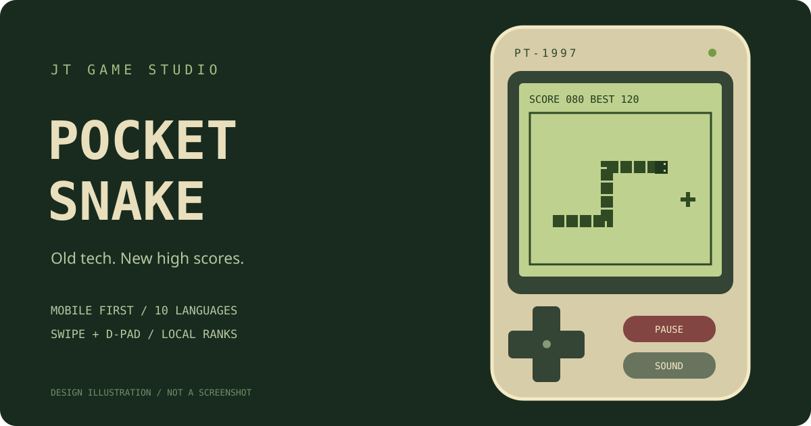

# Pocket Snake · 口袋貪食蛇

A mobile-first retro snake game by JTGameStudio, inspired by old handheld devices and monochrome LCD screens.

由 JTGameStudio 製作的手機優先復古貪食蛇，以舊式掌機、綠色 LCD 螢幕和像素風格重現經典。

[Play / 開始遊戲](https://jtgamestudio.github.io/snake/) · [Repository / 原始碼](https://github.com/JTGameStudio/snake)



Illustration only; not a screenshot. / 圖片為設計示意圖，並非實際遊戲截圖。

## Release status / 版本狀態

This guide describes the updated edition prepared for this project. The updated game file has been generated but has not yet been committed with this documentation change. The live site may still show the earlier interface. This commit updates documentation and artwork only.

本文件介紹本專案已準備的新版本。新版遊戲檔案已生成，但未包含在本次文件提交中；線上網站可能仍顯示舊版介面。本次只更新說明文件及示意圖。

## 繁體中文

### 遊戲介紹

操控持續前進的貪食蛇，收集食物、延長身體並挑戰分數。遊戲採用單頁 HTML，將介面、樣式與 JavaScript 整合於 index.html，無須安裝遊戲或登入帳戶。

### 新版特色

- 手機優先：方形遊戲區、螢幕方向鍵及滑動操作。
- 懷舊外觀：綠色 LCD、像素蛇身、復古機身及合成音效。
- 英文預設：首次開啟使用英文，手動選擇語言後會記住設定。
- 兩步無文字教學：第一次開始遊戲時播放手指向上、向右滑動示範，完成後自動開局；可按 × 跳過。
- 開始面板：選擇語言、左右手佈局、開始遊戲或查看龍虎榜。
- 左右手佈局：左手模式將方向鍵放左邊；右手模式將方向鍵放右邊，功能按鈕移到另一側。
- 即時滑動轉向：手指移動途中觸發，不必等待放開；8px 門檻及最多兩步轉向輸入緩衝。
- 按分數加速：取消手動難度按鈕，隨得分逐步提升移動速度。
- 最近 10 局龍虎榜：遊戲結束後顯示本局成績及排名。
- 暫停保護：可手動暫停；離開頁面或切換應用程式時自動暫停。

### 遊戲規則與速度

1. 每個食物獲得 10 分，蛇身同時增長。
2. 撞牆或撞到自己的身體即結束；不能直接掉頭。
3. 0–10 分維持每步 220ms；20 分開始，每增加 10 分，移動間隔縮短 12ms，最低 65ms。間隔越短，速度越快。
4. 填滿 20 × 20 格遊戲區即可完成挑戰。
5. 開始新一局前若已有暫停中的遊戲，會要求確認；放棄的遊戲不會加入排行榜。

### 操作方式

| 平台 | 操作 |
| --- | --- |
| 手機／平板 | 在遊戲區上下左右滑動，或按方向鍵 |
| 電腦 | 方向鍵或 WASD |
| 暫停／繼續 | 畫面按鈕；電腦亦可用空白鍵（焦點不在按鈕或選單時） |
| 左右手設定 | 開始面板選 Left-handed 或 Right-handed |
| 音效 | 遊戲畫面切換 Sound，設定會記住 |

### 龍虎榜與資料儲存

- 保留最近完成的 10 局，再按分數由高到低排列；不是永久最高分 10 局。
- 同分時，較新一局排先；本局會特別標示並顯示排名。
- 舊版只有最高分，沒有逐局歷史。若在相同網站與瀏覽器讀到舊最高分，新版會將它作為一筆舊版最高分帶入；其後亦會隨最近 10 筆規則淘汰。
- 排行榜、最高分、語言、左右手、音效及教學狀態使用 localStorage 儲存在目前瀏覽器。
- 不提供全球排行榜、帳戶或跨裝置同步。清除網站資料或更換瀏覽器／網站來源後，紀錄不會自動跟隨；儲存不可用時也無法保證保留。

### 支援語言

英文、繁體中文、簡體中文、法文、日文、韓文、西班牙文、德文、葡萄牙文及阿拉伯文，共 10 種。

## English

### About the game

Steer an always-moving snake, collect food, grow longer and chase a higher score. Pocket Snake packages its interface, CSS and JavaScript into a single index.html file. No game installation or account is required.

### Updated-edition features

- Mobile-first square playfield with swipe controls and an on-screen direction pad.
- Retro green LCD styling, pixel graphics, handheld shell and synthesized sound effects.
- English on first launch; later manual language choices are remembered.
- A two-step, text-free first-game tutorial: a finger demonstrates upward and rightward swipes before play starts automatically. Tap × to skip.
- Start menu with language selection, handedness, play and leaderboard access.
- Left-handed layout places the direction pad on the left; right-handed layout places it on the right and swaps the function buttons.
- Responsive turns during pointer movement, an 8px swipe threshold and a two-turn input buffer.
- Score-based acceleration instead of manual speed controls.
- A local leaderboard for the latest 10 completed runs, with the current result highlighted after a game.
- Manual pause and automatic pause when the page loses focus or becomes hidden.

### Rules and progression

1. Each food gives 10 points and extends the snake.
2. Hitting a wall or your own body ends the run. Direct reversals are not allowed.
3. Movement stays at 220ms per step for scores 0–10. Starting at 20 points, every additional 10 points reduces the interval by 12ms, down to a minimum of 65ms. A shorter interval means faster movement.
4. Fill the 20 × 20 board to complete the challenge.
5. Starting over from a paused run asks for confirmation. Abandoned runs are not added to the leaderboard.

### Controls

| Platform | Controls |
| --- | --- |
| Phone / tablet | Swipe in the playfield or tap the direction pad |
| Desktop | Arrow keys or WASD |
| Pause / resume | On-screen buttons; Space on desktop when focus is not on a button or menu |
| Handedness | Choose Left-handed or Right-handed in the start menu |
| Audio | Toggle Sound during play; the preference is remembered |

### Leaderboard and privacy

The game retains the latest 10 completed runs and ranks those runs by score. It is not an all-time top-10 list. Ties favor the newer run. The current result is highlighted with its position.

The earlier edition stored only a best score, not full run history. If that score is available on the same site and browser, the updated edition imports it as one legacy record. It can later age out of the latest-10 list.

Scores and preferences use browser localStorage. There is no global leaderboard, account system or cross-device synchronization. Clearing site data, switching browsers or changing the site origin does not carry records over automatically. Persistence cannot be guaranteed when browser storage is unavailable.

### Languages

English, Traditional Chinese, Simplified Chinese, French, Japanese, Korean, Spanish, German, Portuguese and Arabic.

## Run locally / 本機執行

Open index.html in a modern browser, or serve the project locally:

```sh
python -m http.server 8000
```

Then visit http://localhost:8000/. / 然後開啟 http://localhost:8000/。

## Deploy to GitHub Pages / 部署至 GitHub Pages

1. Commit the updated game as lowercase index.html at the repository root. / 將新版遊戲以小寫 index.html 提交至儲存庫根目錄。
2. Open Settings → Pages. / 開啟 Settings → Pages。
3. Choose Deploy from a branch → main → / (root), then Save. / 選擇 Deploy from a branch → main → / (root)，再按 Save。
4. Check the Pages deployment result under Actions before testing the site. / 到 Actions 確認 Pages 部署結果，再測試網站。

Site / 網址: https://jtgamestudio.github.io/snake/

## Project structure / 專案結構

```text
index.html                     # Game / 遊戲
README.md                      # Bilingual guide / 中英文說明
docs/images/pocket-snake.svg   # Illustration / 示意圖
```

## Technology and testing / 技術與測試

HTML, CSS, JavaScript, Canvas 2D, Pointer Events, Web Audio and localStorage. No external runtime libraries or image downloads are required by the game. The updated edition still needs hands-on testing on target iPhone and Android devices; mobile input feel, layout and audio behavior should be verified before calling it production-ready.

遊戲使用 HTML、CSS、JavaScript、Canvas 2D、Pointer Events、Web Audio 與 localStorage，無須外部執行程式庫或下載遊戲圖片。新版仍需於目標 iPhone、Android 裝置實測，確認滑動手感、版面及音效後再視為正式可用。
